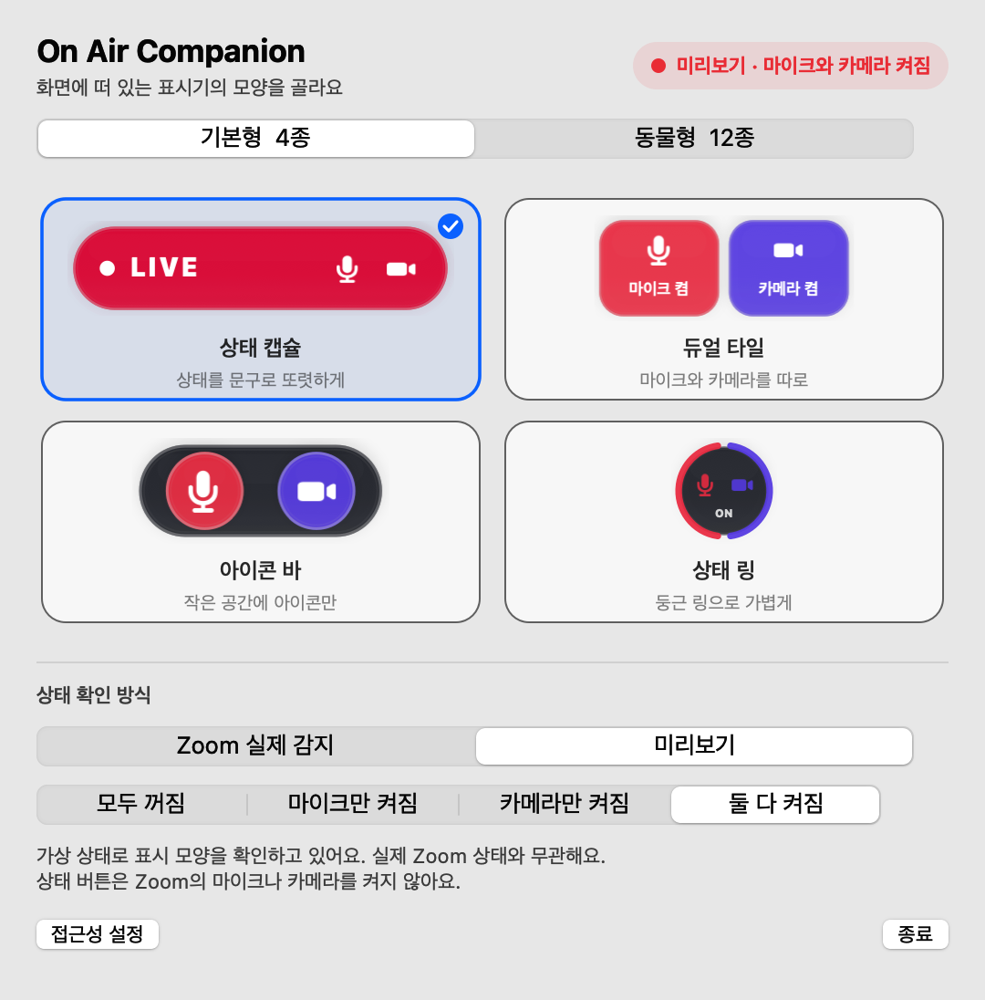
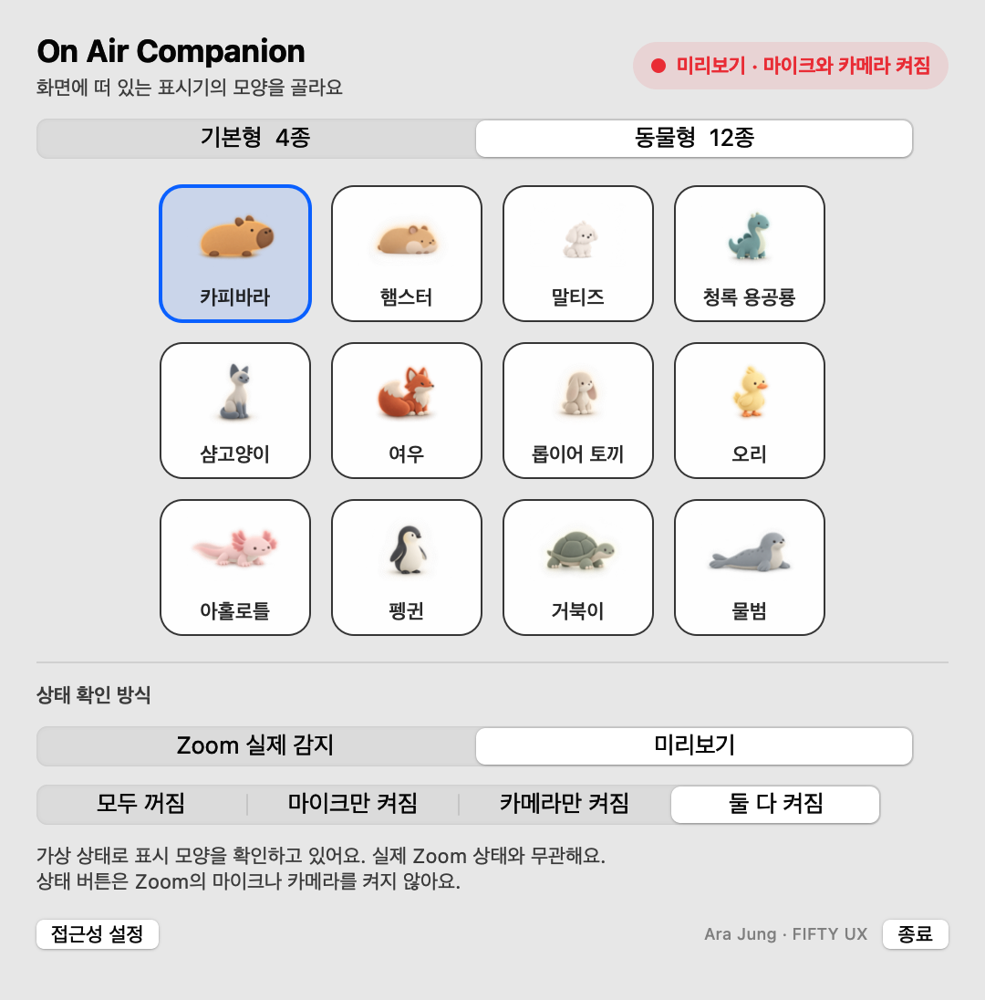

# On Air Companion

Zoom 회의 중 마이크와 카메라 상태를 기본형 또는 동물형으로 보여 주는 macOS 메뉴바 앱입니다.

<p align="center"><strong>Designed and built by Ara Jung · FIFTY UX</strong></p>

<p align="center">
  
  
</p>

## 다운로드

수업 시연용 최신 베타는 [GitHub Releases](https://github.com/arajung-hub/on-air-companion/releases/latest)에서 받을 수 있습니다.

[On Air Companion 베타 ZIP 바로 받기](https://github.com/arajung-hub/on-air-companion/releases/download/v0.1.2-beta/on-air-companion-beta-v8.zip)

<p align="center">
  <a href="https://github.com/arajung-hub/on-air-companion/releases/latest">
    
  </a>
</p>

현재 베타는 Apple Silicon Mac을 대상으로 하며 임시 코드 서명을 사용합니다. 설치 후 시스템 설정의 개인정보 보호 및 보안에서 접근성 권한을 켜야 합니다.

## 프로젝트 배경

Zoom 회의에서 마이크가 켜진 사실을 놓치고 개인 대화를 했던 경험에서 시작했습니다. 작은 상태 표시기가 사용자의 주의를 얼마나 빠르게 환기할 수 있는지 살펴보기 위해, 같은 감지 로직에 정보 중심의 기본형과 감정적인 동물형을 적용했습니다.

## 표시 스타일

### 기본형

상태 캡슐, 듀얼 타일, 아이콘 바, 상태 링 중 하나를 고를 수 있습니다. 상태 캡슐은 상태 문구를 크게 보여 주며, 듀얼 타일은 마이크와 카메라 상태를 따로 표시합니다. 아이콘 바는 작은 공간에 두 아이콘을 담고, 상태 링은 원의 양쪽으로 두 장치의 상태를 보여 줍니다. 선택한 모양은 다음 실행에도 유지됩니다.

네 가지 기본형은 반투명 색면, 유리 테두리, 내부 하이라이트를 공유합니다. 화면에서는 동물형과 같은 강도로 부드럽게 위아래로 움직입니다.

꺼진 장치는 어두운 배경과 빗금으로, 켜진 마이크는 산호색, 켜진 카메라는 보라색으로 구분합니다. 상태 캡슐에서 둘 다 켜진 경우에는 빨간색을 사용합니다.

메뉴바에는 상태마다 macOS 표준 아이콘 하나만 표시합니다. 모두 꺼짐은 확인, 마이크 켜짐은 마이크, 카메라 켜짐은 카메라, 둘 다 켜짐은 녹화, 권한 필요는 경고 아이콘입니다.

### 동물형

카피바라, 햄스터, 말티즈, 청록 용공룡, 샴고양이, 여우, 롭이어 토끼, 오리, 아홀로틀, 펭귄, 거북이, 물범 중 하나를 고를 수 있습니다. 꺼짐 상태에서는 눈을 감고 쉬며 마이크나 카메라가 켜지면 눈을 뜹니다. 카메라가 켜지면 빨간 점이 움직이고, 마이크가 켜지면 산호색 파동이 움직입니다.

두 스타일은 같은 Zoom 감지 로직을 사용합니다. 런처에서 스타일을 바꾸면 떠 있는 표시기와 메뉴바 아이콘이 함께 바뀌며 선택값은 다음 실행에도 유지됩니다.

## 앱 아이콘

앱 번들에 여러 해상도를 포함한 macOS 아이콘을 추가했습니다. Finder와 시스템 설정의 접근성 권한 목록에서 On Air Companion 아이콘을 확인할 수 있습니다.

## 감지 방식

앱은 Zoom Workplace의 접근성 버튼 이름을 읽어 상태를 판별합니다. 실제 음성과 영상 내용은 읽거나 저장하지 않습니다. Zoom 회의가 없으면 떠 있는 표시기는 자동으로 숨고 메뉴바 아이콘만 남습니다.

설정 화면의 상태 확인 방식에서 `Zoom 실제 감지`와 `미리보기`를 따로 고릅니다. 미리보기에서는 모두 꺼짐, 마이크만 켜짐, 카메라만 켜짐, 둘 다 켜짐을 선택할 수 있습니다. 상단 상태 배지에도 미리보기임을 표시합니다. 이 버튼은 실제 Zoom의 마이크와 카메라를 제어하지 않습니다. 실제 감지에서 회의가 없거나 접근성 권한이 필요한 경우에는 각각의 안내가 표시됩니다.

## 첫 실행

1. `On Air Companion.app`을 응용 프로그램 폴더로 옮깁니다.
2. 앱을 실행하고 메뉴바의 상태 아이콘을 누릅니다.
3. 기본형 또는 동물형을 고릅니다.
4. 시스템 설정의 개인정보 보호 및 보안에서 접근성 권한을 켭니다.
5. 앱을 다시 실행하고 Zoom 회의에 들어갑니다.

## 빌드

```bash
./scripts/build-app.sh
```

## 데모

기본형 전체 켜짐:

```bash
./build/On\ Air\ Companion.app/Contents/MacOS/OnAirCompanion --demo-live --style basic --show-picker
```

기본형 모양은 `--basic-variant`로도 고를 수 있습니다. 식별자는 `capsule`, `dual-tiles`, `icon-bar`, `status-ring`입니다.

동물형 전체 켜짐:

```bash
./build/On\ Air\ Companion.app/Contents/MacOS/OnAirCompanion --demo-live --style animal --character maltese --show-picker
```

사용 가능한 캐릭터 식별자는 `capybara`, `hamster`, `maltese`, `teal-dragon`, `siamese-cat`, `fox`, `lop-rabbit`, `duck`, `axolotl`, `penguin`, `turtle`, `seal`입니다.

## 미리보기 내보내기

```bash
./build/On\ Air\ Companion.app/Contents/MacOS/OnAirCompanion --export-previews ./preview
```

기본형 네 가지의 상태별 이미지, 기본형과 동물형 선택 화면, 실제 감지 안내 화면, 메뉴바 아이콘, 동물별 상태를 각각 내보냅니다.

## 현재 범위

현재 배포 파일은 Apple Silicon Mac용 수업 발표 베타입니다. 앱에는 임시 코드 서명이 적용되어 있습니다. 공개 배포용 Developer ID 서명과 Apple 공증은 포함하지 않았습니다.

배포 준비는 [DISTRIBUTION.md](DISTRIBUTION.md), 과제 진행 상태는 [PROJECT_CHECKLIST.md](PROJECT_CHECKLIST.md)에서 확인할 수 있습니다.

5분 발표 순서와 시연 대본은 [PRESENTATION_SCRIPT.md](PRESENTATION_SCRIPT.md)에 정리했습니다.

실제 감지 시연이 어려울 때는 [기본형 시연 영상](preview/demo-basic.mp4)과 [동물형 시연 영상](preview/demo-animals.mp4)을 사용할 수 있습니다.
